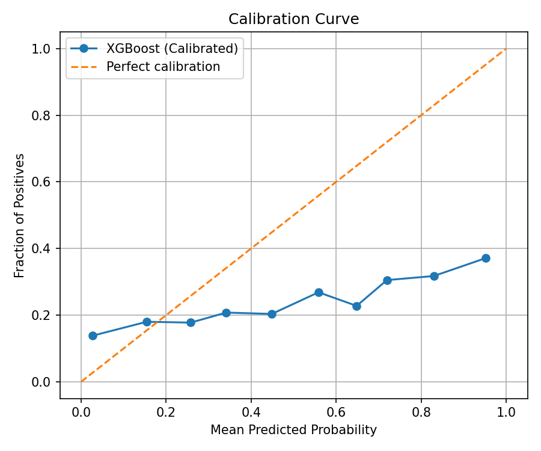
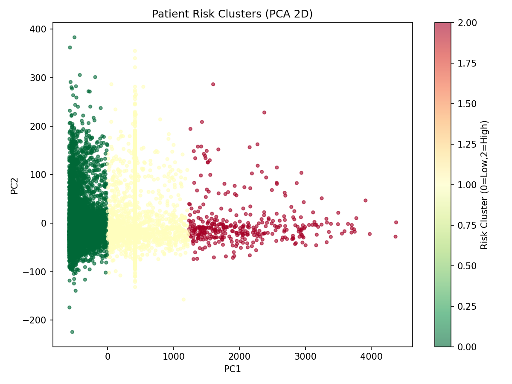

# MIMIC-IV Heart Failure 30-day Readmission

MIMIC-IV 정형 데이터로 **심부전(HF) 입원 환자의 30일 재입원**을 예측하고, 재실기간·위험군을 분석한 팀 프로젝트(메디업, 2025-2, 4인)입니다.
코호트 추출부터 피처 엔지니어링, 모델링까지 노트북 5개로 구성됩니다.

## Problem

심부전은 퇴원 후 재입원이 잦은 질환입니다. 입원 시점에 얻을 수 있는 정보로 30일 재입원 위험을 미리 가려낼 수 있는지,
그리고 어떤 환자군이 위험한지 확인하는 것이 목표입니다.

## Data

- MIMIC-IV (PhysioNet 자격 인증 필요). 원본·가공 데이터는 DUA에 따라 이 저장소에 포함하지 않습니다.
- 코호트: ICD-10 `I50.x` 진단이 있는 심부전 입원 **57,800건** (Train 46,240 / Test 11,560)
- 30일 재입원율 **16.1%** (클래스 불균형 → `scale_pos_weight` 적용)
- 피처: 인구학·과거 입원 이력·동반질환·신장 기능 검사, 그리고 `chartevents`(약 40 GB)를 청크 단위로 읽어 만든 **입원 첫 24시간 바이탈 집계(first/min/max/mean)**

## Method

| 노트북 | 내용 |
|---|---|
| `01_explore_tables.ipynb` | patients·admissions·diagnoses 등 테이블 구조 탐색 |
| `02_cohort_extraction.ipynb` | I50.x 심부전 입원 추출, 재입원 라벨 생성 |
| `03_feature_engineering.ipynb` | 과거 입원·동반질환·검사 피처, 체크포인트 저장 |
| `04_vitals_chartevents.ipynb` | 40 GB chartevents 청크 처리, 첫 24시간 바이탈 집계 |
| `05_modeling.ipynb` | XGBoost/LightGBM 재입원 분류, KMeans+PCA 위험군, t-test/χ², Ridge 재실기간 회귀, 비식별화 확인 |

## Results

- 재입원 분류(XGBoost): AUROC **0.637** (최종 발표 기준), Train–Test 성능 차이를 버그 수정 후 0.12 → 0.07로 줄임
- 위험군(KMeans): 군집별 재입원율 9.6% / 12.3% / 19.3% (`figures/cluster_rates.csv`)
- 재실기간 회귀(Ridge): **누수 컬럼 제거 전후**
  | | MAE | R² |
  |---|---|---|
  | 제거 전 (`los_days`·`icu_total_los` 등 결과 정보 포함) | 2.38일 | 0.614 |
  | 제거 후 | **3.10일** | **0.383** |

  예측 시점에 알 수 없는 재실 정보가 피처에 섞여 성능이 부풀려져 있었습니다. 수치는 떨어졌지만 제거 후 값이 실제로 쓸 수 있는 성능입니다.




## Files

```
notebooks/   # 01~05 (출력 셀 제거: 환자 단위 데이터가 노출되지 않도록)
figures/     # 집계 그래프, 군집별 재입원율
```

## How to run

1. PhysioNet에서 MIMIC-IV 접근 권한을 받아 `data/`에 CSV를 둡니다.
2. 노트북을 01 → 05 순서로 실행합니다. (Python 3, pandas, scikit-learn, xgboost, lightgbm, matplotlib, seaborn)
